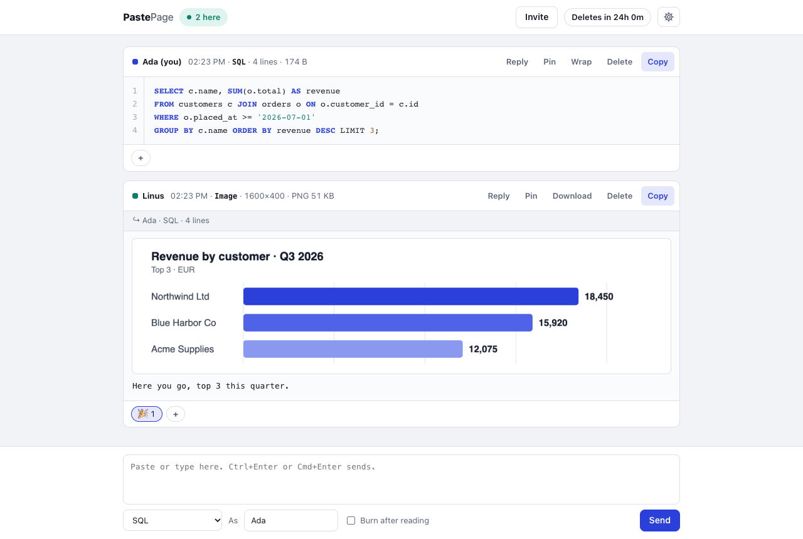

# PastePage

Paste text back and forth between two (or a few) people, live. What you paste arrives exactly as pasted, including Windows line endings, and it is encrypted in your browser before it leaves your computer.

PastePage is a small self-hosted web app: you run it on your own server, next to your other websites. There are no accounts and no database. Sessions live only in the server's memory and disappear when everyone has left.



## Features

- **Exactly what you pasted.** No trimmed spaces, smart quotes or reformatting, and Windows line endings stay as they are. If you type the text, paste into text already in the box, or change a paste before sending it, line breaks are sent as plain LF. Syntax highlighting, line numbers, Wrap and Copy on every note.
- **Live.** New notes, reactions, pins and "2 here" update instantly for everyone in the session.
- **One link to join.** Send the invite link, or send the session name and password separately if you want to be extra careful.
- **Replies, reactions and pins.** Reply to a note, react with 👍 ❤️ 😂 🎉 👀 ✅, pin the notes that matter.
- **Burn after reading.** A note that the first other person can open once, after which it is deleted for everyone.
- **You decide when it's gone.** Sessions are deleted after 1 hour to 7 days (24 hours by default), when someone ends them, or roughly 2-3 minutes after the last person leaves.
- **Light and dark themes, a wide view** that uses the full window width, and six languages: English, Nederlands, Deutsch, Français, Español and 日本語.
- **Loads nothing from other sites**: no CDNs, web fonts, analytics or trackers.

## How it works, and what the server can see

Everyone in a session knows its password. Your browser turns the password into an encryption key, and every note, reply, reaction and pin is encrypted with that key before it is sent. The server only stores and passes on encrypted data, in memory. PastePage itself never writes it to disk, but the operating system could still swap memory to disk, which the app can't control.

The server **cannot** see the text, the names people type or the password. It **can** see the size and timing of what is sent and what kind of event it is (a note, a burn-after-reading note, or a small event such as a reaction, pin or read notice). Encryption does not hide length, so from the size of a small event the server can often tell a reaction from a pin or a read notice, whether it was switched on or off, and sometimes which emoji. It can also see random per-tab ids, the session name, and visitors' IP addresses (used for the abuse limits).

One caveat applies to every web app that encrypts in the browser: the encryption code is delivered by the server. Whoever runs the server could change that code, so you are trusting the person who runs it. Self-hosting means that person is you.

Details: [docs/security.md](docs/security.md).

## Requirements

- **Node.js 22 or newer.** Node 22 is the oldest Node.js line that still gets security fixes (until 30 April 2027); Node 24 is supported until 30 April 2028. Linux distributions often ship an older Node: Ubuntu 24.04's own `nodejs` package is version 18. Get a current one from [nodejs.org](https://nodejs.org/en/download), or on Ubuntu and Debian from [NodeSource](https://github.com/nodesource/distributions). [docs/deployment.md](docs/deployment.md#1-install-nodejs) has the commands. Check with `node --version`.
- **HTTPS**, once other people use it. Browsers only allow the encryption functions on HTTPS pages and on the local machine (`localhost`), so a plain `http://` address won't work. Your web server provides the HTTPS (see below).
- For running it as a service: a Linux server with systemd.

## Install

Try it on your own computer first:

```sh
npx pastepage
```

npx asks before it downloads the package. Then open the address it prints, <http://127.0.0.1:3000/>, in two browser windows: start a session in one, open the invite link in the other.

To keep it installed, pick one of these:

```sh
# The pastepage command, installed globally (on a server you may need sudo)
npm install -g pastepage
pastepage

# Or from a clone of this repository
git clone https://github.com/sidebitio/pastepage.git
cd pastepage
npm install
npm start
```

Stop it with Ctrl+C. `pastepage --help` lists the options.

## How hosting works

PastePage doesn't do HTTPS and doesn't take over ports 80 and 443. It listens on a local port that only the server itself can reach. The web server you already run (Caddy, nginx or Apache) gives it a domain and an HTTPS certificate (from Let's Encrypt, for example) and passes the traffic through. That setup is called a reverse proxy.

```
  visitors' browsers
          │  https://paste.example.com
          ▼
  your web server: Caddy, nginx or Apache
  (ports 80 and 443, the HTTPS certificate)
          │  http://127.0.0.1:3000, inside the server only
          ▼
  PastePage (Node.js), sessions in memory
```

So other people open `https://paste.example.com` (or `https://example.com/pastepage/`). The `http://127.0.0.1:3000` address on its own is only for trying it out on the server or your own computer.

### No web server yet? Install Caddy

[Caddy](https://caddyserver.com) gets and renews the HTTPS certificate by itself.

1. Point your domain's DNS record (A and/or AAAA) at your server, and make sure ports 80 and 443 are open.
2. Install Caddy by following [caddyserver.com/docs/install](https://caddyserver.com/docs/install). On Debian and Ubuntu it then runs as a service.
3. Replace the contents of `/etc/caddy/Caddyfile` with these three lines, using your own domain:
   ```
   paste.example.com {
   	reverse_proxy 127.0.0.1:3000
   }
   ```
4. Run `sudo systemctl reload caddy`.

Caddy fetches the certificate and redirects `http://` to `https://`. Once PastePage is running (next section), `https://paste.example.com` works.

## Run it as a service

[systemd](https://systemd.io) starts PastePage when the server boots and restarts it if it crashes. The full walkthrough, for both install routes, is in [docs/deployment.md](docs/deployment.md#3-run-it-as-a-systemd-service). In short:

1. Create a user for it:
   ```sh
   sudo useradd --system --no-create-home --shell /usr/sbin/nologin pastepage
   ```
2. Copy [`deploy/pastepage.service`](deploy/pastepage.service) to `/etc/systemd/system/pastepage.service`. Set its `ExecStart` line to the path that `command -v pastepage` prints (npm install) or to the git clone's path (see the comments in the file).
3. Enable and start it:
   ```sh
   sudo systemctl daemon-reload
   sudo systemctl enable --now pastepage
   ```
4. Check it and read its log:
   ```sh
   systemctl status pastepage
   sudo journalctl -u pastepage -f
   ```

## Put it behind your web server

Ready-made examples are in [`deploy/`](deploy/), and [docs/deployment.md](docs/deployment.md) explains every line:

- [`deploy/Caddyfile`](deploy/Caddyfile): Caddy, on a subdomain or under a path such as `/pastepage/`.
- [`deploy/nginx.conf`](deploy/nginx.conf): nginx, with the WebSocket headers, a longer read timeout and a 2 MB request size.
- [`deploy/apache.conf`](deploy/apache.conf): Apache 2.4.47 or newer, with `mod_proxy` and `upgrade=websocket`.

**Tested so far:** the Caddy sub-path setup was verified live with Caddy 2.11.7 on macOS (the redirect, live notes through the proxy, a WebSocket kept alive for 70 seconds idle, and the lockout keyed on the visitor's address), and `deploy/Caddyfile` passes `caddy validate`. The nginx and Apache examples have not been tried behind a running web server yet; they were checked line by line against the web server's official documentation. If you run one, please report how it went.

**Web server on another machine?** By default PastePage listens only on `127.0.0.1` and trusts forwarding information only from the same machine. If the web server runs elsewhere, change **both** `HOST` and `TRUST_PROXY`. Otherwise PastePage either can't be reached or sees every visitor as the web server's address, so they all share one wrong-password lockout, one session-creation limit and one share of live connections. See [docs/deployment.md](docs/deployment.md#7-web-server-on-another-machine).

## Configuration

Settings are environment variables. Every one has a safe default, so you only set what you want to change.

| Variable | Default | What it does |
|---|---|---|
| `PORT` | `3000` | Port to listen on. |
| `HOST` | `127.0.0.1` | Address to listen on. Keep `127.0.0.1` when the web server runs on the same machine. |
| `TRUST_PROXY` | `loopback` | Which direct callers may tell PastePage the visitor's real IP address (the `X-Forwarded-For` header): `loopback` (this machine only), `false` (nobody), a comma-separated list of exact IP addresses, or `true` (anyone, not recommended). See [docs/security.md](docs/security.md#trust_proxy). |
| `IDLE_SECONDS` | `120` | A session is deleted this long after the last person left (checked every 10 seconds). |
| `MAX_HOURS` | `168` | The longest a session can be set to last, in hours (default 168, which is 7 days). If it is lower than an option in the page's expiry menu, the longer choices are capped to it. |
| `MAX_NOTE_BYTES` | `1500000` | Largest single note, measured after encryption. That fits about 1.1 MB of plain text, less if the text has many line breaks, tabs, quotes or backslashes. |
| `MAX_SESSION_BYTES` | `12000000` | Most encrypted data one session can hold. "Clear all" makes room again. |
| `MAX_EVENTS` | `2000` | Most events one session can hold (notes, reactions, pins, deletions and so on). |
| `MAX_SESSIONS` | `1000` | Most sessions on the server at once. |
| `MAX_TOTAL_BYTES` | `268435456` | Most encrypted data across all sessions together (256 MiB). |
| `MAX_FAILS` | `10` | Requests with a wrong session name or password from one IP address (for IPv6, one /64 network) within 15 minutes before it is locked out. Joining a session isn't counted; see [docs/security.md](docs/security.md#limits-and-the-lockout). |
| `LOCK_SECONDS` | `900` | How long a locked-out IP address stays locked (15 minutes). |
| `CREATE_PER_HOUR` | `30` | New sessions one IP address (for IPv6, one /64 network) may start per hour. |

Numbers must be whole numbers (0 or more; `MAX_HOURS` at least 1). PastePage refuses to start, with a message, if a setting is invalid.

Ways to set them:

- **With systemd:** add `Environment=` lines to the service file, for example `Environment=CREATE_PER_HOUR=10`.
- **In a `.env` file** in the directory PastePage is started from, one `NAME=value` per line. Real environment variables win over `.env`.
- **On the command line:** `pastepage --port 8080 --host 127.0.0.1`. Flags win over both.

## Updating

```sh
# npm install
sudo npm install -g pastepage@latest

# git clone
cd /opt/pastepage
sudo git pull
sudo npm install
```

Then restart it: `sudo systemctl restart pastepage`. A restart deletes all open sessions, because they only live in memory. Notes on what changed are in [CHANGELOG.md](CHANGELOG.md).

## Translations

The interface is available in English, Dutch, German, French, Spanish and Japanese. It follows the browser's language, and there's a language picker on the page.

The Dutch, German, French, Spanish and Japanese texts are drafts that no native speaker has checked yet. If you speak one of them, Japanese especially, corrections are very welcome, and so are new languages. [CONTRIBUTING.md](CONTRIBUTING.md#translations) explains how.

## License

PastePage is **source-available**, not open source. Its [LICENSE](LICENSE) is the MIT license with the Commons Clause added. In plain words:

- **You may** use it, run it for yourself, your team or your company, read and change the code, and share it, as long as you keep the license notice.
- **You may not** sell it. That means you may not charge others for a product or service whose value comes entirely or substantially from PastePage, including paid hosting of it and paid consulting or support for it.

That restriction is why it isn't "open source" in the sense of the [Open Source Definition](https://opensource.org/osd), which doesn't allow limits on selling. The LICENSE file is the binding text; this summary is not legal advice.

PastePage includes [highlight.js](https://highlightjs.org) (BSD-3-Clause) and uses the [ws](https://github.com/websockets/ws) package (MIT). Their notices are in [THIRD_PARTY_NOTICES.md](THIRD_PARTY_NOTICES.md).

## Security and contributing

- Found a security problem? Please report it privately: see [SECURITY.md](SECURITY.md).
- Want to help? See [CONTRIBUTING.md](CONTRIBUTING.md).

---

Created by [SideBit](https://sidebit.io).
